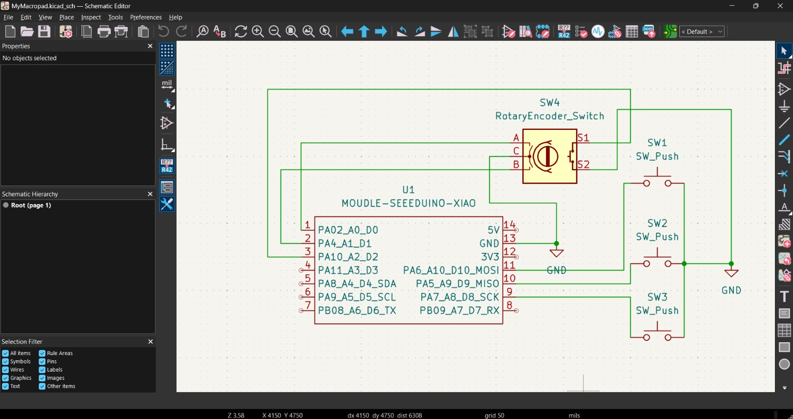
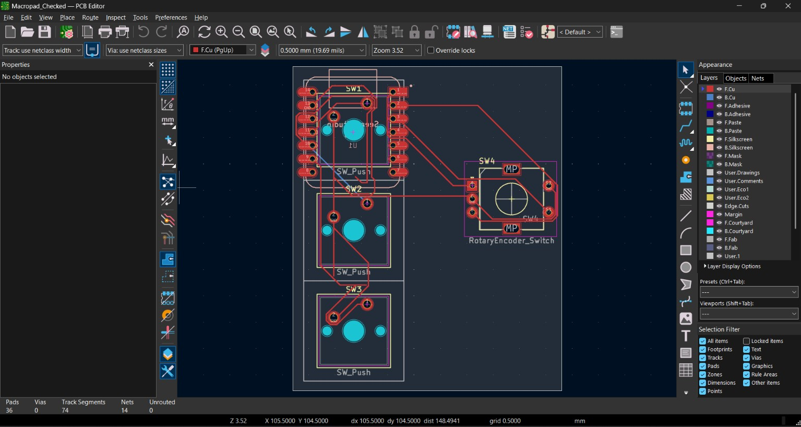
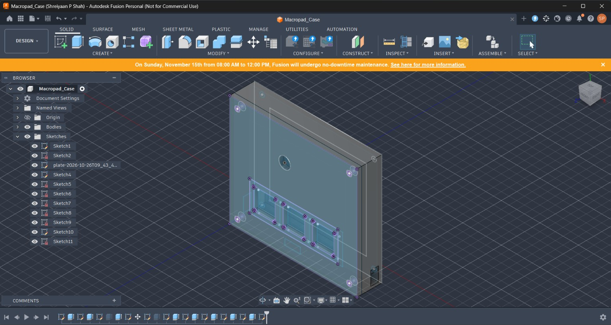

Shreiyaan’s Macropad

This is a three-key macropad with a rotary encoder. I made it for simple media controls and shortcuts that I use regularly. I designed the PCB in KiCad, made the enclosure in Fusion 360, and prepared the firmware using QMK.

The macropad uses a Seeed Studio XIAO RP2040, three MX-style mechanical switches, and an EC11 rotary encoder with a push switch.

The three keys are used for speaker mute, play/pause, and Print Screen. Rotating the encoder changes the volume, and pressing the encoder toggles speaker mute.

I made the enclosure slightly larger so the macropad has a stable base and enough space around the controls to be comfortable on a desk. (and also, so i can design cool things on the case to make it look good)

Schematic:

PCB:

Enclosure:

The folder contains the KiCad schematic and PCB, Gerber and drill files, the STEP enclosure model, BOM, firmware source, compiled UF2 firmware, DRC report and project images.

The PCB DRC has 0 errors and 0 unconnected items. The remaining warnings are mostly related to silkscreen overlapping solder-mask areas.

The firmware has not been tested on assembled hardware yet. I will test the keys and encoder after the PCB is manufactured and assembled.

Made by Shreiyaan P Shah.

